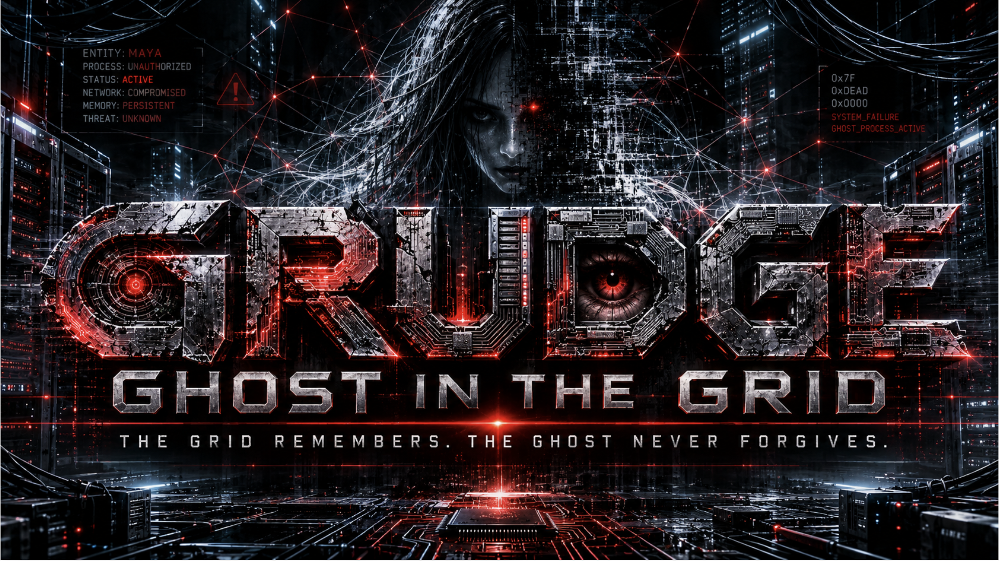

# Network-systems-THE-GRUDGE.-GHOST-IN-THE-GRID.-

The grid remembers. The ghost never forgives.

Core Premise & Tone

• The Setup: A late-night sysadmin or forensic investigator is called into a quiet, isolated office or campus network after a series of "accidental" deaths. Each victim was one of the girl's bullies, and each death aligns with a suspicious network anomaly.
• The Twist/Threat: The girl isn't just haunting the building—her consciousness or malware is embedded across the network topology. She uses physical hardware, smart building systems, and data streams as weapons.

Network Concepts as Horror Mechanics

• Subnetting & VLANs (Safe Zones vs. Quarantine): Network segments act like rooms or wings. Crossing a VLAN boundary without proper authorization triggers alarms or locks doors. Players must segment traffic to isolate threats, risking getting trapped inside a subnet with an entity.
• Packet Sniffing & ARP Spoofing (False Signals & Decoys): Using a packet sniffer lets you see "ghost" traffic—phantom commands sent to lights, elevators, or locks. ARP spoofing lets you redirect where signals go, or tricks you into following false audio/visual cues.
• Latency, Jitter & Packet Loss (Pacing & Hallucinations): High latency delays door unlocks or camera feeds while something approaches. Packet loss causes missing frames on security cameras, glitches in intercom voices, or sudden teleports/jumpscares.
• DDoS & Bandwidth Exhaustion (Overwhelm & Blackouts): Flooding a node overwhelms local defenses, cutting power or comms, while leaving the player blind in the dark until bandwidth recovers.
• DNS Poisoning (Misdirection): Corrupting name resolution sends the player's tools or access requests to the wrong "host"—turning a safe terminal into a trap.
• Firewalls & IDS/IPS (Stealth & Detection): Intrusion Detection Systems act like sensors. Making too much "noise" (unencrypted traffic, port scans, failed logins) raises threat alerts and draws attention.

Narrative & Level Structure

• Each Victim = A Network Layer or Node: Structure chapters around the bullies' roles or spaces—such as the front-desk access control network, the server room's environmental/HVAC system, or remote endpoints tied to their personal devices.
• Environmental Storytelling: Recover chat logs, deleted files, and access timestamps showing how the bullying escalated and how she mapped the network before striking.
• Moral & Psychological Tension: The player uncovers evidence of the bullies' cruelty while surviving lethal traps—forcing choices between protecting remaining data, exposing the truth, or escaping before the network reconfigures.

Visual & Sound Design Ideas

• Topology Map as a Diegetic HUD: A live node-and-link graph shows active connections, packet bursts, and severed links—blinking red when something moves along a path.
• Audio Cues: Dial-up tones, fan whines, relay clicks, and distorted VoIP fragments tied to real-time traffic spikes.
